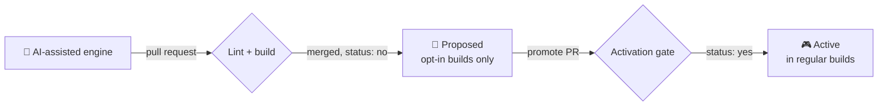

<div align="center">

# 🕹️ ScummVM-AI

### Classic game engines, written with AI help and held to ScummVM's standards.

[](https://github.com/ripleyXLR8/scummvm-AI/actions/workflows/upstream-sync.yml)
[](../COPYING)
[](https://github.com/scummvm/scummvm)

**[Engines](../ENGINES-AI.md)** · **[Contribute](../README-AI.md)** · **[For coding agents](../CLAUDE.md)** · **[Build ScummVM](../README.md)**

</div>

---

Writing a ScummVM engine takes months of specialised work, and upstream ScummVM [doesn't accept AI-authored code](../AI-GUIDELINES.md). **ScummVM-AI is the place to find out what AI-assisted engines can do** when every one of them has to pass a strict, automated review before it reaches players.

> [!NOTE]
> This is an unofficial fork, not affiliated with or endorsed by the ScummVM team. The official project is at **[scummvm.org](https://www.scummvm.org/)**.

## ✨ What you can bring

<table>
<tr>
<td width="50%" valign="top">

### 🔁 Reimplementations
Bring a classic back to life. Players supply their own original data files, as with ScummVM. The work is clean-room, with no copyrighted code or assets in the repository.

</td>
<td width="50%" valign="top">

### 🌱 Original games
Make a new game that runs everywhere ScummVM does: desktop, mobile, consoles and the browser.

</td>
</tr>
</table>

## 🛡️ From idea to players



| | 🧪 Proposed | 🎮 Active |
|---|---|---|
| **Who gets it** | Testers, with `--enable-engine=<name>` | Everyone, in regular builds |
| **Automated checks** | Touches only its own folder, provenance is documented, builds and registers | Plus: zero compiler warnings, AddressSanitizer and UndefinedBehaviorSanitizer, game detection, a recorded playthrough replayed to the end |
| **Human checks** | Responsible human named | Plus: a signed review checklist and maintainer approval |

Every engine, AI-written or not, has a **responsible human** who has read all of its code and answers for it.

## 🔄 Always in step with ScummVM

The fork **only adds files and never edits upstream ones**. Every night it merges ScummVM's `master` and rebuilds every AI engine against it, so when upstream changes break an engine, it shows up within a day. The engine API, backends and the platforms it runs on are all plain ScummVM.

## 🚀 Get started

```sh
git clone https://github.com/ripleyXLR8/scummvm-AI.git && cd scummvm-AI
c++ -o devtools/create_engine/create_engine devtools/create_engine/create_engine.cpp
devtools/create_engine/create_engine mygame        # your engine skeleton
cp .github/ai/PROVENANCE.md engines/mygame/        # say who and what made it
./configure --disable-all-engines --enable-engine=mygame && make -j
```

Then follow **[README-AI.md](../README-AI.md)** to open your pull request. Using a coding agent? Point it to **[CLAUDE.md](../CLAUDE.md)**.

<details>
<summary><b>❓ FAQ</b></summary>

**Will these engines end up in official ScummVM?**
Not as AI-authored code: upstream's guidelines forbid it. Anyone who wants to send an engine upstream has to follow [AI-GUIDELINES.md](../AI-GUIDELINES.md) themselves.

**Can I use AI-generated art in an original game?**
Upstream bans AI-generated art, and this fork has no rule on it yet. Describe whatever you use in your engine's `PROVENANCE.md`.

**How do I credit the AI I used?**
Add an `Assisted-by: AGENT:MODEL` trailer to your commits, and list the tools in `PROVENANCE.md`. Don't use `Co-Authored-By`: an inherited upstream workflow closes PRs that have one.

</details>

---

<div align="center">
<sub>GPLv3 or later, like ScummVM. See <a href="../COPYING">COPYING</a>.</sub>
</div>
